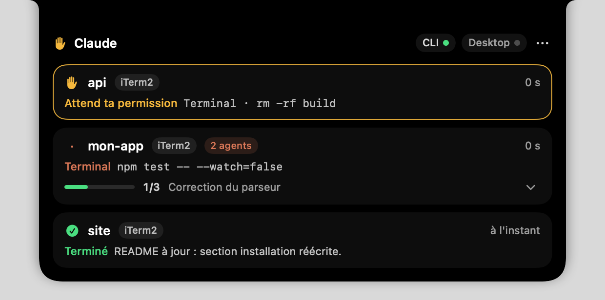
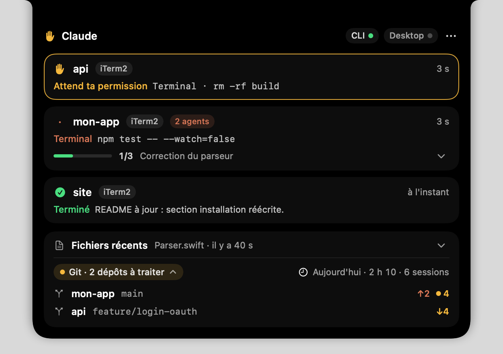

# Claude Notch

A native macOS app that lives in your MacBook's notch and keeps track of your Claude Code sessions,
whether they run in a terminal or an editor (CLI) or in the Code tab of Claude Desktop. Hover the notch
and the panel unfolds with a summary of every session: state, current tool, task list, subagents.

<p align="center">
  
</p>
<p align="center">
  
</p>

Interface available in English and French (follows the system language). Screenshots use sample data.

*Not affiliated with or endorsed by Anthropic. Claude is a trademark of Anthropic.*

[Version française plus bas](#français)

## Features

- **Session states at a glance**: ready, thinking, running a tool (with the command or the file),
  waiting for your permission, waiting for your answer, plan to review, done, error, compacting the context.
  Sessions that need you are listed first, with an amber outline.
- **Collapsed notch with two "ears"**: the left one shows the overall state (a raised hand when a session
  needs you, a spinner while Claude works, a check mark when a turn ends); the right one shows
  `active sessions·running subagents`, for example `1·6`, or the progress of the task list (`2/5`).
- **Permissions**: the card shows what Claude is asking for (`Terminal · rm -rf build`, the file to edit,
  the question asked).
- **Reply from the notch** (Settings › Claude, off by default): allow or deny a permission (with an optional
  reason for Claude), answer a question (single or multiple choice, or your own text), approve a plan or ask
  for changes, and send a message to a session (hover its card: **Message**). The terminal dialog stays usable
  at the same time: the first answer wins. Never "always allow" from the notch. Return sends, Esc closes.
- **Tasks**: progress bar and current task of Claude Code's task list; the chevron unfolds the whole list.
- **Subagents**: number of subagents running in each session.
- **Click to go back**: clicking a card brings the host app to the front (Terminal, iTerm2, Ghostty, VS Code,
  Claude Desktop…). For a session in the Code tab of Claude Desktop, the click opens that exact session.
- **Claude Desktop**: a row shows whether Claude Desktop is open, with a button to bring it to the front.
- **Optional tools section**: files recently written by Claude, Git status of your repositories, today's usage.
  It only appears when its data files exist (see [Tools section](#tools-section)).
- Works on screens without a notch too (external display, closed lid): a small notch is drawn at the top
  center of the screen.

<p align="center">
  
</p>

## Installation

1. Download `ClaudeNotch-<version>.dmg` from the [Releases](https://github.com/Slybald/claude-notch/releases) page.
2. Open it and drag **ClaudeNotch** onto **Applications**.
3. Optional: check the download against the `.sha256` file published next to it:
   `shasum -a 256 -c ClaudeNotch-<version>.dmg.sha256` (run it in the download folder).

### First launch

Claude Notch is not notarized (there is no Apple Developer ID behind it; releases are signed with a
self-signed certificate), so macOS blocks it the first time you open it. Two ways around it:

- Open the app once, dismiss the warning, then go to **System Settings › Privacy & Security**, scroll down
  and click **Open Anyway** next to the message about ClaudeNotch. Confirm.
- Or, in Terminal:

  ```sh
  xattr -dr com.apple.quarantine /Applications/ClaudeNotch.app
  ```

The certificate is the same for every release, so macOS recognises each update as the same app and keeps the
accesses you granted (calendar, Bluetooth, Automation, folders). Older versions were signed ad hoc, a signature
that changes with every build: when you move to the first release signed with the certificate, macOS asks for
these accesses one last time, then no longer.

On first launch, a window offers to install the Claude Code hooks. It adds Claude Notch's entries to
`~/.claude/settings.json` (a timestamped backup is written next to it first, and your existing hooks are kept)
and installs the hook script in `~/.claude/hooks/`. You can reinstall them later from the **…** menu ›
**Installer les hooks**. Sessions that were already open show up at their next message.

### Requirements

- macOS 13 Ventura or later, Apple silicon or Intel.
- Claude Code (CLI, or the Code tab of Claude Desktop).
- Claude Code configuration in `~/.claude`. `CLAUDE_CONFIG_DIR` is not supported by the app: the hooks are
  always installed in `~/.claude`.

## Updates

Claude Notch updates itself from the [Releases](https://github.com/Slybald/claude-notch/releases) page.

- 60 seconds after launch, then every 6 hours, the app asks GitHub for the latest release
  (`api.github.com`; only the app version is sent, in the User-Agent). Drafts and pre-releases are ignored.
- A newer version is downloaded with its signature (`ClaudeNotch-<version>.dmg.sig`) and installed only if
  its Ed25519 signature matches the public key built into the app. A DMG without a signature, or with an
  invalid one, is refused and nothing is installed.
- At launch, a new version is installed right away; later on, only when no session is running or waiting
  for you (otherwise the app tries again every 10 minutes). The app then restarts by itself and the **…** menu
  shows "Updated to X".
- Automatic installation needs the app in `/Applications` or `~/Applications`, in a folder you can write to.
  Otherwise the **…** menu offers to open the release page.
- To turn it off: **…** menu › uncheck **Automatic Updates**. New versions are then only announced in the
  menu, with an **Install** button. **Check for Updates** checks right away.
- Apps built from source (`scripts/build.sh`, `scripts/install.sh`) never update themselves: the menu shows
  "Development build: updates disabled".

## Privacy

- Everything stays on your Mac. Claude Notch sends no data about you or your sessions: no analytics. Its only
  outgoing requests are the update check to `api.github.com` and the download of new versions from GitHub
  (see [Updates](#updates)).
- The app listens on `127.0.0.1:47823` only, on the loopback interface: it cannot be reached from the network.
- The hook script only talks to that local address, with `curl`. Every request carries a token that the app
  generates at each launch and writes to `~/Library/Application Support/ClaudeNotch/hook-token` (readable by
  your account only); curl reads it from that file, so it never shows in the process list. The app refuses any
  request without it, with another `Host` than `127.0.0.1:47823`, or with an `Origin` header (a web page).
  The other way round, a decision or a message from the app carries a second secret (`hook-proof`, same
  folder, never sent by the script): without it, the script ignores the answer, so a program that takes the
  port while the app is closed (another account on a shared Mac) decides nothing.
- Replies from the notch: the app only ever answers a request made by a Claude Code hook, after a click in the
  notch. No route lets another program decide in your place, and there is no "always allow". When anything
  fails (app not running, setting off, delay over), the hook hands control back to the terminal: never an
  approval by default.
- What the app reads: the hook events, the end of the transcript of a running session (to detect Esc),
  Claude Code's task files, the process list (to find the host app).
- What the app writes: two local logs and the token files in `~/Library/Application Support/ClaudeNotch/` (see
  [Shared logs](#shared-logs)), the hooks in `~/.claude` when you ask for it, and during an update the DMG in
  `~/Library/Caches/io.github.slybald.claudenotch/updates/` (deleted afterwards) and the new app in place of
  the old one. The messages you type are sent to the Claude Code session only, never stored.

## How it works

- Each hook event is relayed by `curl` to `http://127.0.0.1:47823/hook`, along with the hook's parent process
  ID and a few environment variables. These hooks are declared `async: true`: they add no latency to Claude.
- Two more kinds of hooks serve "Reply from the notch":
  - `PermissionRequest` also runs the script synchronously (`permission` mode, 600 s timeout). The terminal
    dialog shows up at the same time and stays usable; the first answer wins. The app holds the request until
    you click, and otherwise answers "no decision": after 4 s if you have not opened its card in the notch,
    after about 590 s if you have, as soon as the tool runs or the turn moves on, or when you answer in the
    terminal. With the setting off, the hook returns at once.
  - `SessionStart` and `Stop` start a waiting hook (`inbox` mode, `asyncRewake`): it waits in the background
    for a message typed in the notch, then hands it to Claude, who starts a turn (about 3 s). During a turn, the
    message is read after the current action. Without a waiting hook (session opened before the hooks were
    updated, app restarted), the message is queued until the end of the turn. Messages are capped at
    1,800 bytes and control characters are removed. Sessions without a terminal (`claude -p`, the Agent SDK,
    IDEs, the Code tab of Claude Desktop) do not get messages from the notch: there, Claude waits for this hook
    before reading the prompt, so the app lets it go at once (measured with Claude Code 2.1.304).
- After an update of the app, hooks installed by a previous version are updated silently, with the usual
  timestamped backup of `settings.json`.
- From that process ID, the app walks up the process tree to find the Claude process (to detect the end of
  the session) and the host app (Terminal, iTerm2, Ghostty, VS Code, Claude Desktop…). A session with Claude
  Desktop among its ancestors is a Desktop session; the click opens it with
  `claude://code/continue?session=local_…` (the ID comes from `CLAUDE_CODE_HOST_SESSION_ID`).
- If the app is not running, the hook relaunches it on the next `SessionStart` or `UserPromptSubmit`.
- Interrupting with Esc fires no hook: during a turn, the app reads the end of the transcript every second and
  switches the session back to "ready" when it finds the interruption.
- Diagnostics: `GET http://127.0.0.1:47823/state` returns the state of the sessions and of the notch as JSON
  (read only, local only, with the token:
  `curl -H @"$HOME/Library/Application Support/ClaudeNotch/hook-token" http://127.0.0.1:47823/state`).

## Tools section

A compact card between the session list and the Claude Desktop row. Each part only shows up when its file exists:

- **Recent files** (folded by default, the header shows the latest one): the last 5 distinct paths of
  `files.jsonl`, excluding temporary folders (`/tmp`, `/var/folders`, scratch spaces). A deleted file is greyed
  out. Click: Finder selects the file (or its parent folder if it is gone).
- **Git**, from `~/Library/Application Support/GitRadar/state.json` when it is less than 2 hours old:
  "everything pushed" or "N repositories to deal with", with branch, commits to push or pull, local changes.
- **Usage**, from `~/Library/Application Support/ClaudeUsage/today.json` when it is dated today: active time
  and number of sessions.

The files are only read while the panel is open (every 15 s, on a background queue); nothing runs while it is
folded. The Git and usage files are produced by separate command-line tools that are not part of this repository.

### Companion tool jobs

If companion tools are installed in `~/.local/share/<tool>/` (`git-radar`, `claude-usage`, `course-sorter`,
`claude-recap`), Claude Notch runs their background jobs itself instead of LaunchAgents: macOS denies
`~/Documents`, `~/Desktop` and `~/Downloads` to scripts started by launchd, while the access granted once to
an app is inherited by the processes it starts. A missing tool is skipped. Logs:
`~/Library/Logs/ClaudeNotch/<tool>.log`; state: `jobs` key of `/state`. Releases keep the same signing
certificate, so these accesses survive updates. An app built from source is signed ad hoc and loses them at
each build.

## Shared logs

The app appends one JSON line per event to two files in `~/Library/Application Support/ClaudeNotch/`, from
hooks it already receives:

- `files.jsonl`: every file written by Claude (successful `PostToolUse` of Write, Edit, MultiEdit,
  NotebookEdit): `{"ts", "path", "tool", "session_id", "project", "cwd", "source"}`.
- `permissions.jsonl`: every permission request: `{"ts", "session_id", "project", "tool", "detail"}`, where
  `detail` is the first line of the command for Bash, the file path for an edit, otherwise the tool's short
  description, truncated to 200 characters.

## Limitations

- Chat conversations in Claude Desktop do not go through hooks: for them, only "Claude Desktop open /
  frontmost" is shown.
- A session opened before the hooks were installed only appears at its next message.
- After a permission is granted in the terminal, the card stays on "waiting for your permission" until the
  tool finishes: no hook reports the approval itself. (Granted from the notch, the card updates at once.)
- Reply from the notch: a session opened before the hooks were updated receives replies only after it
  restarts. Sessions without a terminal (Code tab of Claude Desktop, `claude -p`, SDK) cannot receive a
  message (no **Message** button); permissions, questions and plans are not checked with them.
- Esc while Claude is thinking, before any text: Claude writes nothing to the transcript, so the card stays on
  "thinking" until the next event.
- A `claude` session started from a terminal opened inside Claude Desktop is classified as Desktop (Claude.app
  is among its ancestors).
- Logs are only written while the app runs (the hook relaunches the app only at the start of a session or a
  turn). They are never rotated (about 250 bytes per line); beyond 16 MB, the app only reads the end of
  `files.jsonl`.
- `permissions.jsonl` also contains AskUserQuestion and ExitPlanMode: Claude Code routes them through
  `PermissionRequest`.
- Task list: the TaskCreate/TaskUpdate tools are only enabled by default on some models. Otherwise, set
  `CLAUDE_CODE_ENABLE_TODO_TOOLS=1`. Claude Code deletes the task files once the whole list is done: the
  progress bar then disappears.

## Uninstall

**…** menu › **Désinstaller Claude Notch…** removes the hooks and what the app installed, then quits.
Then drag `ClaudeNotch.app` from Applications to the Trash.

## Development

Swift Package (no Xcode project), Swift 5.10 tools, macOS 13+.
Code map and design decisions: [docs/ARCHITECTURE.md](docs/ARCHITECTURE.md).

```sh
swift build
swift test
scripts/build.sh      # universal (arm64 + x86_64) build/ClaudeNotch.app, signed ad hoc by default
scripts/make-dmg.sh   # build/ClaudeNotch-<version>.dmg and its .sha256, checked after creation
```

- `VERSION=1.2.3 scripts/build.sh` sets the app version (default: `CFBundleShortVersionString` of
  `Resources/Info.plist`). `RELEASE_CHANNEL=1` marks the app as a release build
  (`ClaudeNotchUpdateChannel = release` in its Info.plist): only those update themselves.
- `SIGN_KEYCHAIN=<keychain> SIGN_IDENTITY=<certificate name> scripts/build.sh` signs with that certificate
  instead of ad hoc (both variables or neither). This is what the release workflow does; local builds stay ad
  hoc, and macOS asks again for its accesses after each one.
- `scripts/install.sh` builds and installs from source; `scripts/uninstall.sh` removes it.
- Translations: `Resources/en.lproj` and `Resources/fr.lproj`. The French text in the code is the key;
  `LocalizationTests` checks that every key used in the code has an English translation.
- PNG snapshots of the panel, with sample data: `CLAUDE_NOTCH_SNAPSHOT_DIR=/some/folder swift test --filter SnapshotTests`.
- **Publishing a release** = pushing a `vX.Y.Z` tag. GitHub Actions runs the tests, builds the universal app
  in version X.Y.Z with `RELEASE_CHANNEL=1`, makes the DMG, signs it with the `UPDATE_SIGNING_KEY` secret
  (`scripts/update-signing.swift`, the job fails if signing fails or if the key does not match the one built
  into the app) and creates the release with the DMG, its SHA-256 and its signature. Installed copies pick it
  up on their own.

  ```sh
  git tag v1.1.0
  git push origin v1.1.0
  ```

  The private signing key is also in the maintainer's keychain. Losing it breaks automatic updates for every
  existing installation: they only accept DMGs signed with that key.
- **Code signature**: the release workflow signs the app with a self-signed certificate (CN `Claude Notch
  Self-Signed`, code signing, 10 years) so that its designated requirement stays the same from one version to
  the next and macOS keeps the accesses granted to the app (TCC). Two more repository secrets are needed:
  `SIGNING_CERT_P12` (the `.p12`, base64) and `SIGNING_CERT_PASSWORD`; the job fails right away without them.
  The workflow imports the certificate into a temporary keychain and deletes it at the end. Backup in the
  maintainer's login keychain, as generic passwords with service `io.github.slybald.claudenotch.code-signing`
  and accounts `p12-base64` and `p12-password`. To put the secrets back from it:

  ```sh
  S=io.github.slybald.claudenotch.code-signing
  printf %s "$(security find-generic-password -s $S -a p12-base64 -w)" | gh secret set SIGNING_CERT_P12 -R Slybald/claude-notch
  printf %s "$(security find-generic-password -s $S -a p12-password -w)" | gh secret set SIGNING_CERT_PASSWORD -R Slybald/claude-notch
  ```

  Do not replace this certificate lightly: a new one changes the requirement and every user gets the access
  prompts again.

## License

[MIT](LICENSE).

---

## Français

App macOS native qui vit dans la notch du MacBook et suit les sessions Claude Code, dans un terminal ou un
éditeur (CLI) comme dans l'onglet Code de Claude Desktop. Survole la notch : le panneau se déplie et résume
chaque session (état, outil en cours, liste de tâches, sous-agents). Interface disponible en anglais et en
français (suit la langue du système). Les captures ci-dessus utilisent des données fictives.

*Projet indépendant, ni affilié à Anthropic ni approuvé par Anthropic. Claude est une marque d'Anthropic.*

### Fonctionnalités

- **États des sessions** : prête, réfléchit, outil en cours (avec la commande ou le fichier), attend ta
  permission, attend ta réponse, plan à valider, terminé, erreur, compacte le contexte. Les sessions qui
  t'attendent passent en tête, avec un contour ambre.
- **Notch repliée avec deux « oreilles »** : à gauche l'état global (main levée quand une session t'attend,
  un spinner pendant que Claude travaille, une coche à la fin d'un tour) ;
  à droite `sessions actives·sous-agents en cours`, par exemple `1·6`, ou l'avancement de la liste de tâches
  (`2/5`).
- **Permissions** : la carte montre ce que Claude demande (`Terminal · rm -rf build`, le fichier à modifier,
  la question posée).
- **Répondre depuis la notch** (Réglages › Claude, désactivé par défaut) : autoriser ou refuser une
  permission (avec un motif facultatif pour Claude), répondre à une question (choix unique ou multiple, ou
  texte libre), approuver un plan ou demander des changements, et écrire à une session (survole sa carte :
  **Écrire**). Le dialogue du terminal reste utilisable en même temps : la première réponse gagne. Jamais de
  « toujours autoriser » depuis la notch. Entrée envoie, Échap ferme.
- **Tâches** : barre de progression et tâche en cours de la liste de Claude Code ; le chevron déplie la liste.
- **Sous-agents** : nombre de sous-agents en cours dans chaque session.
- **Clic → retour à la session** : un clic sur une carte ramène l'app hôte au premier plan (Terminal, iTerm2,
  Ghostty, VS Code, Claude Desktop…). Pour une session de l'onglet Code de Claude Desktop, le clic ouvre
  cette session précise.
- **Claude Desktop** : une ligne indique si Claude Desktop est ouvert, avec un bouton pour le ramener devant.
- **Section outils (optionnelle)** : fichiers récemment écrits par Claude, état Git de tes dépôts, usage du
  jour. Elle n'apparaît que si ses fichiers de données existent (voir [Section outils](#section-outils)).
- Marche aussi sur un écran sans notch (écran externe, capot fermé) : une petite notch est dessinée en haut
  au centre de l'écran.

### Installation

1. Télécharge `ClaudeNotch-<version>.dmg` depuis la page [Releases](https://github.com/Slybald/claude-notch/releases).
2. Ouvre-le et glisse **ClaudeNotch** sur **Applications**.
3. Facultatif : vérifie le téléchargement avec le fichier `.sha256` publié à côté :
   `shasum -a 256 -c ClaudeNotch-<version>.dmg.sha256` (dans le dossier du téléchargement).

#### Premier lancement

Claude Notch n'est pas notarisée (pas de compte Apple Developer ID ; les releases sont signées avec un
certificat auto-signé) : macOS la bloque à la première ouverture. Deux façons de passer outre :

- Ouvre l'app une fois, ferme l'avertissement, puis va dans **Réglages Système › Confidentialité et
  sécurité**, descends et clique sur **Ouvrir quand même** à côté du message sur ClaudeNotch. Confirme.
- Ou, dans le Terminal :

  ```sh
  xattr -dr com.apple.quarantine /Applications/ClaudeNotch.app
  ```

Le certificat est le même à chaque release : macOS reconnaît chaque mise à jour comme la même app et garde les
accès que tu as accordés (calendrier, Bluetooth, Automation, dossiers). Les versions précédentes étaient
signées ad hoc, une signature qui change à chaque build : au passage à la première release signée avec le
certificat, macOS redemande ces accès une dernière fois, puis plus jamais.

Au premier lancement, une fenêtre propose d'installer les hooks de Claude Code. Elle ajoute les entrées de
Claude Notch dans `~/.claude/settings.json` (une sauvegarde horodatée est faite à côté avant, tes hooks
existants sont conservés) et installe le script de hook dans `~/.claude/hooks/`. Tu peux les réinstaller
plus tard depuis le menu **…** › **Installer les hooks**. Une session déjà ouverte apparaît à son prochain
message.

#### Prérequis

- macOS 13 Ventura ou plus récent, Apple silicon ou Intel.
- Claude Code (CLI, ou onglet Code de Claude Desktop).
- Configuration de Claude Code dans `~/.claude`. `CLAUDE_CONFIG_DIR` n'est pas pris en charge par l'app :
  les hooks sont toujours installés dans `~/.claude`.

### Mises à jour

Claude Notch se met à jour seule depuis la page [Releases](https://github.com/Slybald/claude-notch/releases).

- 60 secondes après le lancement, puis toutes les 6 heures, l'app demande à GitHub la dernière release
  (`api.github.com` ; seule la version de l'app part, dans le User-Agent). Brouillons et préversions sont
  ignorés.
- Une version plus récente est téléchargée avec sa signature (`ClaudeNotch-<version>.dmg.sig`) et n'est
  installée que si sa signature Ed25519 correspond à la clé publique intégrée à l'app. Un DMG sans signature,
  ou à la signature invalide, est refusé et rien n'est installé.
- Au lancement, la nouvelle version s'installe tout de suite ; ensuite, seulement quand aucune session n'est
  en cours ni ne t'attend (sinon l'app réessaie toutes les 10 minutes). L'app redémarre alors seule et le
  menu **…** affiche « Mis à jour en X ».
- L'installation automatique demande que l'app soit dans `/Applications` ou `~/Applications`, dans un dossier
  où tu peux écrire. Sinon, le menu **…** propose d'ouvrir la page de la release.
- Pour la désactiver : menu **…** › décoche **Mises à jour automatiques**. Les nouvelles versions sont alors
  seulement signalées dans le menu, avec un bouton **Installer**. **Rechercher les mises à jour** vérifie
  tout de suite.
- Une app compilée depuis les sources (`scripts/build.sh`, `scripts/install.sh`) ne se met jamais à jour
  seule : le menu affiche « Build de développement : mises à jour désactivées ».

### Confidentialité

- Tout reste sur ton Mac. Claude Notch n'envoie aucune donnée sur toi ni sur tes sessions : pas de
  statistiques. Ses seules requêtes sortantes sont la recherche de mise à jour sur `api.github.com` et le
  téléchargement des nouvelles versions depuis GitHub (voir [Mises à jour](#mises-à-jour)).
- L'app n'écoute que sur `127.0.0.1:47823`, sur l'interface de bouclage : elle est injoignable depuis le réseau.
- Le script de hook ne parle qu'à cette adresse locale, avec `curl`. Chaque requête porte un jeton que l'app
  génère à chaque lancement et écrit dans `~/Library/Application Support/ClaudeNotch/hook-token` (lisible par
  ton compte seulement) ; curl le lit dans ce fichier, il n'apparaît donc jamais dans la liste des processus.
  L'app refuse toute requête sans lui, avec un autre `Host` que `127.0.0.1:47823` ou avec un en-tête `Origin`
  (une page web). Dans l'autre sens, une décision ou un message de l'app porte un second secret (`hook-proof`,
  même dossier, jamais envoyé par le script) : sans lui, le script ignore la réponse. Un programme qui prend le
  port pendant que l'app est fermée (un autre compte sur un Mac partagé) ne décide donc rien.
- Réponses depuis la notch : l'app ne fait jamais que répondre à la requête d'un hook de Claude Code, après un
  clic dans la notch. Aucune route ne permet à un autre programme de décider à ta place, et il n'y a pas de
  « toujours autoriser ». Au moindre échec (app fermée, réglage coupé, délai passé), le hook rend la main au
  terminal : jamais d'autorisation par défaut.
- Ce que l'app lit : les événements de hook, la fin du transcript d'une session en cours (pour détecter
  Esc), les fichiers de tâches de Claude Code, la liste des processus (pour trouver l'app hôte).
- Ce que l'app écrit : deux journaux locaux et les fichiers du jeton dans
  `~/Library/Application Support/ClaudeNotch/` (voir [Registres partagés](#registres-partagés)), les hooks dans
  `~/.claude` quand tu le demandes et, pendant une mise à jour, le DMG dans
  `~/Library/Caches/io.github.slybald.claudenotch/updates/` (supprimé ensuite) et la nouvelle app à la place de
  l'ancienne. Les messages que tu tapes partent à la session Claude Code seulement, sans être enregistrés.

### Fonctionnement

- Chaque événement de hook est relayé par `curl` vers `http://127.0.0.1:47823/hook`, avec le PID du
  processus parent du hook et quelques variables d'environnement. Ces hooks sont déclarés `async: true` :
  aucune latence pour Claude.
- Deux autres sortes de hooks servent à « Répondre depuis la notch » :
  - `PermissionRequest` lance aussi le script en synchrone (mode `permission`, timeout de 600 s). Le dialogue
    du terminal s'affiche en même temps et reste utilisable ; la première réponse gagne. L'app tient la
    demande jusqu'à ton clic, sinon elle répond « pas de décision » : après 4 s si tu n'as pas ouvert sa carte
    dans la notch, après 590 s environ si tu l'as ouverte, dès que l'outil tourne ou que le tour avance, ou
    quand tu réponds au terminal. Réglage coupé, le hook rend la main tout de suite.
  - `SessionStart` et `Stop` lancent une attente (mode `inbox`, `asyncRewake`) : elle attend en arrière-plan
    un message tapé dans la notch, puis le remet à Claude, qui démarre un tour (3 s environ). Pendant un tour,
    le message est lu après l'action en cours. Sans attente (session ouverte avant la mise à jour des hooks,
    app relancée), le message reste en file jusqu'à la fin du tour. Taille limitée à 1 800 octets, caractères
    de contrôle retirés. Les sessions sans terminal (`claude -p`, SDK, IDE, onglet Code de Claude Desktop) ne
    reçoivent pas de message depuis la notch : Claude y attend la fin de ce hook avant de lire le prompt, l'app
    le libère donc tout de suite (mesuré avec Claude Code 2.1.304).
- Après une mise à jour de l'app, des hooks posés par une version précédente sont mis à jour sans rien
  demander, avec la sauvegarde horodatée habituelle de `settings.json`.
- À partir de ce PID, l'app remonte la chaîne de processus pour trouver le processus Claude (détection de
  fin de session) et l'app hôte (Terminal, iTerm2, Ghostty, VS Code, Claude Desktop…). Une session qui a
  Claude Desktop parmi ses ancêtres est une session Desktop ; le clic l'ouvre avec
  `claude://code/continue?session=local_…` (identifiant transmis par `CLAUDE_CODE_HOST_SESSION_ID`).
- Si l'app est fermée, le hook la relance au prochain `SessionStart` ou `UserPromptSubmit`.
- Une interruption par Esc ne déclenche aucun hook : pendant un tour, l'app relit la fin du transcript chaque
  seconde et repasse la session en « Prête » si elle y trouve l'interruption.
- Diagnostic : `GET http://127.0.0.1:47823/state` renvoie l'état des sessions et de la notch en JSON
  (lecture seule, local uniquement, avec le jeton :
  `curl -H @"$HOME/Library/Application Support/ClaudeNotch/hook-token" http://127.0.0.1:47823/state`).

### Section outils

Une carte compacte entre la liste des sessions et la ligne Claude Desktop. Chaque partie n'apparaît que si
son fichier existe :

- **Fichiers récents** (replié par défaut, l'en-tête montre le dernier) : les 5 derniers chemins distincts de
  `files.jsonl`, hors dossiers temporaires (`/tmp`, `/var/folders`, espaces jetables). Un fichier supprimé
  est grisé. Clic : le Finder sélectionne le fichier (ou son dossier parent s'il a disparu).
- **Git**, depuis `~/Library/Application Support/GitRadar/state.json` s'il a moins de 2 h : « tout est
  poussé » ou « N dépôts à traiter », avec branche, commits à pousser ou à récupérer, modifications locales.
- **Usage**, depuis `~/Library/Application Support/ClaudeUsage/today.json` s'il est daté du jour : temps
  actif et nombre de sessions.

Les fichiers ne sont lus que panneau ouvert (toutes les 15 s, sur une queue de fond) ; replié, rien ne
tourne. Les fichiers Git et usage viennent d'outils en ligne de commande séparés, absents de ce dépôt.

#### Tâches des outils compagnons

Si des outils compagnons sont installés dans `~/.local/share/<outil>/` (`git-radar`, `claude-usage`,
`course-sorter`, `claude-recap`), Claude Notch lance lui-même leurs tâches de fond à la place de
LaunchAgents : macOS refuse `~/Documents`, `~/Desktop` et `~/Downloads` aux scripts démarrés par launchd,
alors que l'accès accordé une fois à une app est hérité par les processus qu'elle lance. Un outil absent est
ignoré. Journaux : `~/Library/Logs/ClaudeNotch/<outil>.log` ; état : clé `jobs` de `/state`. Les releases
gardent le même certificat de signature, ces accès survivent donc aux mises à jour. Une app compilée depuis
les sources est signée ad hoc et les perd à chaque build.

### Registres partagés

L'app ajoute une ligne JSON par événement à deux fichiers de `~/Library/Application Support/ClaudeNotch/`, à
partir de hooks qu'elle reçoit déjà :

- `files.jsonl` : chaque fichier écrit par Claude (`PostToolUse` réussi de Write, Edit, MultiEdit,
  NotebookEdit) : `{"ts", "path", "tool", "session_id", "project", "cwd", "source"}`.
- `permissions.jsonl` : chaque demande de permission : `{"ts", "session_id", "project", "tool", "detail"}`,
  où `detail` est la 1re ligne de la commande pour Bash, le chemin du fichier pour une édition, sinon la
  description courte de l'outil, tronqué à 200 caractères.

### Limites

- Les conversations « chat » de Claude Desktop ne passent pas par les hooks : seul l'état « Claude Desktop
  ouvert / au premier plan » est affiché pour elles.
- Une session ouverte avant l'installation des hooks n'apparaît qu'à son prochain message.
- Après une permission accordée dans le terminal, la carte reste en « Attend ta permission » jusqu'à la fin
  de l'outil : aucun hook ne signale l'accord lui-même. (Accordée depuis la notch, la carte suit tout de suite.)
- Répondre depuis la notch : une session ouverte avant la mise à jour des hooks ne reçoit les réponses
  qu'après son redémarrage. Une session sans terminal (onglet Code de Claude Desktop, `claude -p`, SDK) ne peut
  pas recevoir de message (pas de bouton **Écrire**) ; permissions, questions et plans pas vérifiés avec elles.
- Esc pendant la réflexion, avant le moindre texte : Claude n'écrit rien dans le transcript, la carte reste en
  « Réfléchit » jusqu'au prochain événement.
- Une session `claude` lancée depuis un terminal ouvert dans Claude Desktop est classée Desktop (Claude.app
  figure parmi ses ancêtres).
- Registres : écrits seulement pendant que l'app tourne (le hook ne relance l'app qu'au début d'une session
  ou d'un tour). Pas de rotation (environ 250 octets par ligne) ; au-delà de 16 Mo, l'app ne lit que la fin
  de `files.jsonl`.
- `permissions.jsonl` contient aussi AskUserQuestion et ExitPlanMode : Claude Code les fait passer par
  `PermissionRequest`.
- Liste de tâches : les outils TaskCreate/TaskUpdate ne sont actifs par défaut que sur certains modèles.
  Sinon, `CLAUDE_CODE_ENABLE_TODO_TOOLS=1`. Claude Code supprime les fichiers de tâches quand toute la liste
  est terminée : la barre disparaît.

### Désinstallation

Menu **…** › **Désinstaller Claude Notch…** retire les hooks et ce que l'app a installé, puis la quitte.
Jette ensuite `ClaudeNotch.app` du dossier Applications à la Corbeille.

### Développement

Swift Package (pas de projet Xcode), swift-tools 5.10, macOS 13+.
Carte du code et décisions de conception (en anglais) : [docs/ARCHITECTURE.md](docs/ARCHITECTURE.md).

```sh
swift build
swift test
scripts/build.sh      # build/ClaudeNotch.app universelle (arm64 + x86_64), signée ad hoc par défaut
scripts/make-dmg.sh   # build/ClaudeNotch-<version>.dmg et son .sha256, vérifié après création
```

- `VERSION=1.2.3 scripts/build.sh` fixe la version de l'app (par défaut : `CFBundleShortVersionString` de
  `Resources/Info.plist`). `RELEASE_CHANNEL=1` marque l'app comme build de release
  (`ClaudeNotchUpdateChannel = release` dans son Info.plist) : seules celles-là se mettent à jour seules.
- `SIGN_KEYCHAIN=<trousseau> SIGN_IDENTITY=<nom du certificat> scripts/build.sh` signe avec ce certificat au
  lieu d'ad hoc (les deux variables, ou aucune). C'est ce que fait le workflow de release ; les builds locaux
  restent ad hoc et macOS redemande leurs accès après chacun.
- `scripts/install.sh` compile et installe depuis les sources ; `scripts/uninstall.sh` retire tout.
- Traductions : `Resources/en.lproj` et `Resources/fr.lproj`. Le texte français du code sert de clé ;
  `LocalizationTests` vérifie que chaque clé utilisée dans le code a sa traduction anglaise.
- Captures PNG du panneau, avec des données fictives :
  `CLAUDE_NOTCH_SNAPSHOT_DIR=/un/dossier swift test --filter SnapshotTests`.
- **Publier une version** = pousser un tag `vX.Y.Z`. GitHub Actions lance les tests, compile l'app universelle
  en version X.Y.Z avec `RELEASE_CHANNEL=1`, fabrique le DMG, le signe avec le secret `UPDATE_SIGNING_KEY`
  (`scripts/update-signing.swift` ; le job échoue si la signature échoue ou si la clé ne correspond pas à
  celle intégrée à l'app) et crée la release avec le DMG, son SHA-256 et sa signature. Les installations
  existantes la récupèrent seules.

  ```sh
  git tag v1.1.0
  git push origin v1.1.0
  ```

  La clé privée de signature est aussi dans le trousseau du mainteneur. La perdre casse la mise à jour
  automatique de toutes les installations existantes : elles n'acceptent que les DMG signés avec cette clé.
- **Signature du code** : le workflow de release signe l'app avec un certificat auto-signé (CN `Claude Notch
  Self-Signed`, signature de code, 10 ans) pour que son exigence désignée reste identique d'une version à
  l'autre et que macOS garde les accès accordés à l'app (TCC). Deux secrets de dépôt de plus sont nécessaires :
  `SIGNING_CERT_P12` (le `.p12`, en base64) et `SIGNING_CERT_PASSWORD` ; le job échoue tout de suite sans eux.
  Le workflow importe le certificat dans un trousseau temporaire et le supprime à la fin. Sauvegarde dans le
  trousseau de session du mainteneur, en mots de passe génériques de service
  `io.github.slybald.claudenotch.code-signing` et de comptes `p12-base64` et `p12-password`. Pour remettre les
  secrets depuis cette sauvegarde :

  ```sh
  S=io.github.slybald.claudenotch.code-signing
  printf %s "$(security find-generic-password -s $S -a p12-base64 -w)" | gh secret set SIGNING_CERT_P12 -R Slybald/claude-notch
  printf %s "$(security find-generic-password -s $S -a p12-password -w)" | gh secret set SIGNING_CERT_PASSWORD -R Slybald/claude-notch
  ```

  Ne remplace pas ce certificat à la légère : un nouveau change l'exigence et tous les utilisateurs
  revoient les demandes d'accès.

### Licence

[MIT](LICENSE).
