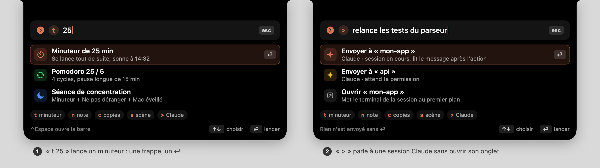
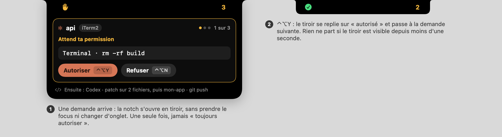

# Idées pour Oriel

Pistes pour les prochaines versions, à choisir : ce ne sont pas des engagements. Écrit le 2026-10-21 sur la base de la
1.7.0 (les intercalaires de la 1.8.0 sont en cours de fusion : PR #11).

**Lecture.** ★ = dans le TOP 5. **Effort** (estimation de bout en bout : fonction, tests, doc, CI, sans les aléas) :
**S** ≈ 1 à 2 h, **M** ≈ 3 à 6 h, **L** ≈ 1 à 2 jours. Toute idée respecte la règle du produit : elle marche sans
Claude Code ni Codex, rien n'est imposé, un onglet désactivé ne travaille pas.

## 1. Où en est le produit, et ce qui manque

Il existe : 10 onglets (Claude, Codex, Lecteur + calendrier, Réglages rapides, Étagère, Presse-papiers, Minuteur,
Notes, Messages, Mail), onglets réorganisables, 4 profils, oreilles en rotation, mode plein écran compact, raccourcis
globaux, mises à jour signées, 0 % de CPU au repos. Pas de contenu qui vit **hors de l'onglet ouvert** à part les
oreilles, pas de barre de commande, pas de tâches, pas de quotas Claude/Codex, pas de moyen pour qu'un script
affiche quelque chose.

Les autres apps de notch, d'après leurs sites et la presse (prix et versions : à revérifier) :

| App | Ce qu'elle fait | Ce qui lui manque ou fâche |
|---|---|---|
| NotchNook (payant) | étagère + AirDrop, widgets, HUD volume, miroir caméra | CPU et batterie, blocages au survol, permission Accessibilité confuse |
| Alcove (payant) | transitions très soignées, HUD, gestes, AirPods | pas d'étagère, plein écran sur écran externe |
| DynamicLake (payant) | réunions, notifications d'autres apps avec réponse, plugins (2.0) | Accessibilité + Notifications obligatoires, réglages touffus |
| boring.notch, Atoll (GPL, gratuits) | lecteur, calendrier, étagère, activités | non signé, mémoire, 5 permissions (Atoll) |
| Vibe Island, Vibeclove (payants) | agents de code : approuver, répondre, quotas, saut vers le bon terminal | agents seulement, ou presque ; essai de quelques jours |
| CodeIsland, Vibe Notch (libres) | agents de code, « smart suppress », push téléphone | mono-agent ou développement en pause |

**Ce qui rend Oriel unique, à garder** : gratuit, sans télémétrie ; agents de code **et** vie quotidienne dans la
même notch ; sobre ; 0 % de CPU au repos. **Les trous du marché** : la plainte n°1 (CPU, batterie) n'a pas de réponse
chiffrée (je n'ai trouvé aucune mesure publiée) ; les apps d'agents ne visent pas le grand public ; un script ne peut pas poser
une oreille sans plugin (DynamicLake 2.0 en annonce, d'après une source secondaire).

## 2. Les 24 idées

### Productivité

**1. ★ Agenda vivant** · effort M
- *Problème* : on rate le début d'une réunion ; le calendrier de l'onglet Lecteur ne vit que quand on l'ouvre.
- *Idée* : la prochaine réunion devient un intercalaire qui compte à rebours (discret à 15 min, ambre à 5 min, « en cours »),
  et un onglet **Agenda** avec un bouton **Rejoindre** qui ouvre le lien du rendez-vous (Zoom, Meet, Teams, FaceTime).
- *Permissions et risques* : Calendriers (déjà demandé par le Lecteur). Le texte d'un événement vient d'un tiers : on
  n'ouvre que `https` et `facetime`, seulement sur clic.
- *Désirable* : sert à tous (cours, rendez-vous, visio), zéro réglage, et c'est le premier contenu « vivant » des intercalaires.

**2. Tâches (Rappels)** · effort M
- *Problème* : une liste à faire demande d'ouvrir une autre app.
- *Idée* : onglet **À faire** branché sur Rappels : cocher, ajouter une ligne, oreille « 3 aujourd'hui ».
- *Permissions et risques* : Rappels (accès complet), clé `NSRemindersFullAccessUsageDescription` à ajouter à l'`Info.plist`
  (absente). Sur macOS 13, ancienne API `requestAccess(to:)`.
- *Désirable* : annoncée par plusieurs apps de notch (NotchNook, boring.notch, MacNotch) ; synchronisée avec l'iPhone sans compte à créer.

**3. Séance de concentration** · effort S
- *Problème* : se mettre au travail = minuteur + Ne pas déranger + Mac éveillé, trois gestes.
- *Idée* : une scène des Réglages rapides qui lance le minuteur (Pomodoro), la caféine, et le raccourci Focus de l'utilisateur.
- *Permissions et risques* : macOS n'offre aucune API pour activer Focus ; la scène lance un raccourci que l'utilisateur crée
  (comme la tuile Focus actuelle).
- *Désirable* : le cas d'usage étudiant en un clic ; réutilise des briques existantes.

**4. Presse-papiers : actions** · effort M
- *Problème* : on copie une image ou une mise en forme dont on n'a pas besoin.
- *Idée* : sur une copie : **texte brut**, **copier le texte d'une image** (OCR), lire un QR code, copier une couleur en hex ou RGB ;
  en option, **résumer / traduire / corriger** avec le modèle d'Apple sur l'appareil.
- *Permissions et risques* : aucune de plus (accès « coller » déjà géré). OCR : `RecognizeTextRequest` (macOS 15) ou
  `VNRecognizeTextRequest` avant. Modèle Apple : macOS 26+, Mac compatible, Apple Intelligence activé ; l'option disparaît sinon,
  et un résumé peut être faux (étiquette « généré »).
- *Désirable* : tout reste sur le Mac, ce qui est un argument de confiance face aux apps en ligne.

**5. Dictée locale** · effort M
- *Problème* : prendre une note ou écrire à Claude au clavier est lent, surtout en cours ou en réunion.
- *Idée* : un bouton micro dans Notes et dans le champ de discussion Claude ; la transcription se fait sur le Mac.
- *Permissions et risques* : Microphone et Reconnaissance vocale (deux clés `Info.plist` à ajouter) ; `SpeechTranscriber` n'existe
  qu'à partir de macOS 26 (garde `#available`, bouton absent avant) ; le système télécharge le modèle de langue.
- *Désirable* : étudiants, créatifs, et développeurs qui parlent à leur agent ; voyant micro de macOS visible, donc honnête.

**6. Bilan du jour** · effort M
- *Problème* : on ne sait pas ce qu'on a fait de sa journée.
- *Idée* : à l'heure choisie, une carte : cycles de concentration, sessions et fichiers écrits par Claude (le journal
  `files.jsonl` existe déjà), minutes de lecture ; image partageable rendue par l'app.
- *Permissions et risques* : aucune ; l'historique est local, désactivé par défaut, effaçable, fichier en 0600 comme les autres.
- *Désirable* : le plaisir d'un « récap » sans compte ni serveur ; donne une raison de rouvrir la notch le soir.

**7. Pauses santé (20-20-20, eau, posture)** · effort S
- *Problème* : les yeux et le dos se rappellent à nous trop tard.
- *Idée* : un mode du Minuteur : toutes les 20 min, une oreille douce « regarde au loin 20 s », réglable.
- *Permissions et risques* : notifications déjà demandées par le minuteur ; rien sinon.
- *Désirable* : utile à tous, très peu de code, bon argument pour les profils Étudiant et Créatif.

### Intégrations

**8. ★ Approuver au clavier, file unique Claude + Codex** · effort M
- *Problème* : une demande de permission arrive pendant qu'on tape ailleurs ; il faut ouvrir l'onglet, trouver la carte, viser le bouton.
- *Idée* : un **tiroir** sous la notch montre la demande (commande, projet, file « 1 sur 3 ») ; **⌃⌥Y** autorise, **⌃⌥N** refuse.
  Pas de tiroir si le terminal de la session est déjà au premier plan (« smart suppress »). Jamais de « toujours autoriser ».
- *Permissions et risques* : aucune (raccourcis Carbon, sans Accessibilité). Risque : approuver par réflexe. Garde-fous :
  désactivé par défaut, touches actives 1 s après l'apparition, une seule fois, refus par défaut au délai.
- *Désirable* : ce que les apps d'agents payantes vendent ; ici gratuit, pour les deux agents, avec le même geste.

**9. ★ Jauges de quota Claude et Codex** · effort M
- *Problème* : on découvre la limite en la heurtant.
- *Idée* : un anneau fin dans l'onglet (fenêtre 5 h et 7 jours) et une oreille « 82 % » au-delà d'un seuil, avec l'heure de remise à zéro.
- *Permissions et risques* : pour Claude, il faut chaîner la `statusLine` (une seule commande possible) : opt-in, sauvegarde, retrait propre.
  Absent hors abonnement Pro/Max. Pour Codex, aucun accès de plus que ceux de l'onglet ; absent avec une clé d'API (pas de compte ChatGPT).
- *Désirable* : la fonction n°1 des apps d'agents ; chiffre fiable, local, qui évite l'interruption en pleine tâche.

**10. Saut exact vers l'onglet du terminal** · effort M
- *Problème* : un clic sur une carte ramène iTerm2 ou Terminal, pas la bonne fenêtre quand il y en a douze.
- *Idée* : retrouver l'onglet ou le panneau de la session (iTerm2, Terminal, tmux) et le mettre au premier plan.
- *Permissions et risques* : Automation de chaque terminal (une demande au premier clic) ; Ghostty et VS Code : pas d'API d'onglet
  connue (non vérifié). Repli sur le comportement actuel.
- *Désirable* : le geste qu'on fait cent fois par jour quand plusieurs agents tournent.

**11. ★ API locale, commande `notch` et lien `oriel://`** · effort M
- *Problème* : on veut voir « build fini » ou « rendu terminé » dans la notch ; les concurrents annoncent des plugins (DynamicLake 2.0) ou rien.
- *Idée* : `notch run -- make` affiche un sablier puis ✓ ou ✗ avec la durée ; `notch ears --text "12 non lus"` pose une oreille
  pour 60 s ; mêmes appels depuis Raccourcis (action « Ouvrir l'URL ») ou n'importe quel script.
- *Permissions et risques* : le serveur local et son jeton existent déjà. Un lien `oriel://` peut être déclenché par une page
  web : réservé à du texte court et temporaire, désactivé par défaut. Texte et symboles filtrés, 3 éléments au plus.
- *Désirable* : des « plugins » sans charger de code (écarté par `docs/EDITIONS.md`), donc sans risque de signature ; chacun
  fabrique son intercalaire.

**12. Paroles dans le Lecteur** · effort M
- *Problème* : le Lecteur montre le titre, pas ce qui se chante.
- *Idée* : une ligne de paroles sous la pochette ; synchronisée si une source la fournit.
- *Permissions et risques* : Music par AppleScript (Automation) ne donne que des paroles fixes ; une source en ligne envoie
  titre et artiste à un tiers (service non vérifié) : option désactivée par défaut, dite dans la confidentialité.
- *Désirable* : visible par tous, peu risqué si l'option reste facultative.

**13. Étagère : actions au dépôt, dernières captures** · effort M
- *Problème* : un fichier déposé sur l'étagère sert souvent à le réduire, le zipper ou en tirer le texte (l'envoi par AirDrop existe déjà).
- *Idée* : au dépôt : réduire une image, zipper, copier le texte (OCR), convertir en JPEG ; en option, une vignette après
  chaque capture d'écran, à glisser ailleurs.
- *Permissions et risques* : les captures vont sur le Bureau par défaut : dossier protégé, donc une demande d'accès ; à défaut, rien.
- *Désirable* : Dropover et CleanShot en ont fait leur métier ; ici dans la notch, sans une app de plus.

### Interface et animations

**14. ★ Barre de commande** · effort M
- *Problème* : agir demande de trouver le bon onglet ; 10 onglets, beaucoup de clics.
- *Idée* : un raccourci ouvre un champ dans la notch : `t 25` lance un minuteur, `n idée` crée une note, `c lien` cherche dans les copies,
  `s présentation` applique une scène, `> relance les tests` écrit à une session Claude. Rien ne part sans ⏎.
- *Permissions et risques* : aucune. Risque : une grammaire qui grossit ; cinq verbes, pas de langage naturel.
- *Désirable* : le plus rapide pour qui connaît Raycast, et pourtant lisible pour les autres (les préfixes s'affichent).

**15. Accueil « Aujourd'hui »** · effort L
- *Problème* : voir où en sont l'agenda, le minuteur, les messages et Claude oblige à passer d'onglet en onglet.
- *Idée* : un premier onglet de 4 à 6 tuiles réorganisables (prochaine réunion, minuteur, non lus, lecture en cours, état de Claude, quota).
- *Permissions et risques* : celles des modules affichés ; un module fournit sa tuile par une méthode optionnelle du contrat `NotchModule`.
- *Désirable* : l'écran par défaut des profils Minimal et Étudiant ; à faire après 1, 9 et 14, qui lui fournissent ses tuiles.

**16. Toasts système** · effort M
- *Problème* : brancher le chargeur ou connecter ses AirPods ne se voit pas dans la notch.
- *Idée* : une oreille brève : « AirPods 87 % » à la connexion, « charge 54 % » au branchement.
- *Permissions et risques* : aucune de plus ; l'état Bluetooth passe déjà par `IOBluetooth` (API privée chargée à l'exécution, signalée dans le README) ; le branchement du chargeur par les notifications d'IOKit (`IOPowerSources`).
- *Désirable* : le petit plaisir d'iOS, en sobre : un seul événement, 3 s, un simple fondu avec « Réduire les animations ».

**17. Gestes : balayage à deux doigts** · effort S
- *Problème* : changer d'onglet demande de viser une icône de 17 pt.
- *Idée* : balayage horizontal sur le panneau = onglet suivant ou précédent ; sur la notch repliée, balayage vers le bas = ouvrir.
- *Permissions et risques* : aucune (événements reçus par notre propre fenêtre) ; conflit possible avec les listes qui défilent (axe horizontal seulement) ; à vérifier : la fenêtre repliée laisse-t-elle passer la souris (`ignoresMouseEvents`) ?
- *Désirable* : fluide au trackpad, un bouton reste l'alternative (accessibilité).

**18. Couleur d'ambiance du Lecteur** · effort S
- *Problème* : le Lecteur est neutre, l'intercalaire de musique aussi.
- *Idée* : le liseré et un fond très léger prennent la couleur dominante de la pochette.
- *Permissions et risques* : aucune. Contraste borné ; coupé avec « Augmenter le contraste ».
- *Désirable* : la partie la plus « waouh » du Lecteur, pour peu de code.

### Personnalisation

**19. Profils personnalisés, partage et profils automatiques** · effort M
- *Problème* : les 4 profils sont figés ; on veut « au bureau » et « à la maison », ou envoyer sa disposition à un ami.
- *Idée* : enregistrer ses onglets, ordre, ouverture et oreilles sous un nom ; export en fichier ; bascule automatique selon l'écran
  externe branché, l'heure ou le secteur.
- *Permissions et risques* : aucune. Un profil qui masque un onglet arrête son module (un minuteur en cours sonnerait plus) : jamais de bascule automatique qui masque un onglet actif.
- *Désirable* : « la notch s'adapte à ma journée » ; je n'ai vu aucune app de notch qui le fasse (Ice le fait pour la barre des menus).

**20. Accent par onglet et par agent** · effort S
- *Problème* : Claude et Codex se ressemblent d'un coup d'œil.
- *Idée* : une couleur par onglet (liseré de l'intercalaire, icône) ; Claude orange, Codex bleu par défaut.
- *Permissions et risques* : aucune ; ne jamais être le seul signal (voir 22).
- *Désirable* : lisible de loin, personnalisable sans écran de réglages de plus.

### Accessibilité

**21. VoiceOver : annonces d'état et navigation des cartes** · effort M
- *Problème* : les étiquettes existent, mais rien n'annonce « Claude attend ta permission » à qui ne voit pas l'écran.
- *Idée* : annonce VoiceOver à chaque changement d'état d'agent, fin de minuteur, réunion proche ; ↑↓ et ⏎ dans les cartes.
- *Permissions et risques* : aucune. Non testable sans session VoiceOver réelle (à prévoir).
- *Désirable* : rend l'outil utilisable sans voir l'écran ; rien n'indique que les apps de notch le traitent (non vérifié).

**22. Lisibilité : taille du texte, contraste, « sans la couleur »** · effort M
- *Problème* : l'app ne lit que « Réduire les animations ».
- *Idée* : respecter « Augmenter le contraste », « Différencier sans la couleur » (un symbole par état en plus de la couleur) et
  « Réduire la transparence » ; réglage de taille du texte (90 à 130 %).
- *Permissions et risques* : aucune ; la mise en page doit rester sous 460 pt (`LayoutTests`).
- *Désirable* : confort pour tous, obligation pour certains.

### Performance

**23. Mode sobre automatique** · effort S
- *Problème* : sur batterie ou à chaud, une animation décorative coûte pour rien.
- *Idée* : en mode économie d'énergie ou sous forte chaleur : arrêt des barres d'égaliseur et des spinners, sondes plus lentes.
- *Permissions et risques* : aucune (`isLowPowerModeEnabled`, `thermalState`). Risque faible.
- *Désirable* : répond à la plainte n°1 du marché.

**24. Page « Santé »** · effort S
- *Problème* : on dit « 0 % au repos » sans le montrer.
- *Idée* : Réglages › Santé : chaque module (actif ou arrêté), temps CPU et mémoire depuis le lancement, bouton « Copier le rapport » pour un ticket.
- *Permissions et risques* : aucune ; les mesures existent déjà dans `FootprintTests`.
- *Désirable* : une preuve publiable ; confiance, et diagnostic plus rapide.

## 3. TOP 5 recommandé

Ordre conseillé : 1 et 2 s'appuient presque entièrement sur du code existant ; 3 et 4 donnent le gros du « waouh » ; 5 ouvre le terrain.

| # | Idée | Pourquoi | Effort |
|---|---|---|---|
| ★1 | Agenda vivant (idée 1) | Utile à tous les profils, aucune permission nouvelle, premier contenu vivant des intercalaires | M |
| ★2 | Approuver au clavier (idée 8) | Le cœur du produit pour les développeurs ; presque tout existe déjà (`decide`, raccourcis) | M |
| ★3 | Jauges de quota (idée 9) | La fonction que les apps d'agents payantes mettent en avant ; faisabilité vérifiée sur la doc (Claude) et le protocole (Codex), pas en session réelle | M |
| ★4 | Barre de commande (idée 14) | Relie tous les onglets, aucune permission, change la façon d'utiliser la notch | M |
| ★5 | API locale et `notch` (idée 11) | Les « plugins » d'un concurrent, sans charger de code ; chacun fabrique ses intercalaires | M |

Hors top 5, à surveiller : **Tâches** (2) vient juste après ; **Accueil** (15) devient naturel quand 1, 9 et 14 existent.

Maquettes : [barre de commande](ideas/commande.png), [agenda vivant](ideas/agenda.png), [approbation au clavier](ideas/approbation.png)
(voir § 5).

### ★1 Agenda vivant : mini-plan

- **Fichiers.** Nouveau dossier `Sources/ClaudeNotch/Modules/Agenda/` (`AgendaModule`, `AgendaModels` pur : prochain événement,
  seuils, lien de réunion ; `AgendaViews`). `Modules/Media/MediaCalendar.swift` : sortir `CalendarSource`, `EventKitCalendar` et
  `MediaEvent` dans un fichier commun et ajouter `location`, `notes`, `url` à l'événement. Une ligne dans `ModuleRegistry.standardModules`,
  tables `Agenda.strings` (fr, en), `Profiles.swift` (Étudiant), `SetupAssistant` (ligne d'usage), tests `AgendaTests` et rendu PNG.
- **Mécanisme.** Aujourd'hui le calendrier ne tourne que si l'onglet Lecteur est ouvert (`calendarActive`). Ici : `keepsRunningWhenCollapsed`
  seulement si l'accès est accordé *et* qu'il reste un événement aujourd'hui ; une seule échéance planifiée (début − 15 min, − 5 min, début, fin)
  plus l'observateur `EKEventStoreChanged` : aucun sondage. Oreilles `video.fill` + « 4 min », priorité au-dessus du minuteur à 5 min.
- **Faisabilité vérifiée.** SDK macOS 27 : `location`, `notes`, `URL` sont des propriétés d'`EKCalendarItem` ; le lien se trouve par
  expression régulière (`zoom.us/j/`, `meet.google.com/`, `teams.microsoft.com/l/meetup-join`, `webex.com`, `facetime.apple.com`). Pas de nouvelle clé `Info.plist`.
- **À mesurer.** Réveil unique : 0 % de CPU entre deux échéances (`FootprintTests`). Événements sans lien : pas de bouton, « Voir dans Calendrier » reste.

### ★2 Approuver au clavier : mini-plan

- **Fichiers.** `HotKeys.swift` (cases `approve` et `deny` de `HotKeyCenter.Slot`, enregistrées seulement tant qu'une demande attend, puis retirées :
  les touches ne sont volées à personne le reste du temps), nouveau `Modules/Claude/ApprovalQueue.swift` (fusionne `ReplyCenter.requests` et
  `CodexApprovals.requests`, ordre d'arrivée ; `approve()` et `deny()` appellent les `decide` existants), `NotchViews.swift` et `NotchController.swift`
  (présentation « tiroir », fenêtre sans activation comme aujourd'hui), `Preferences.swift` (réglage éteint par défaut), `SettingsWindow.swift`
  (volet Claude et Codex), `ProcessInspector` (l'app hôte est-elle au premier plan ? pour le « smart suppress »).
- **Faisabilité vérifiée.** `HotKeyCenter` utilise `RegisterEventHotKey` (aucune autorisation d'Accessibilité) et signale déjà une combinaison refusée (`unavailable`) ;
  `ReplyCenter.decide(_:_:)` et `CodexApprovals.decide(_:_:)` existent ; aucune permission nouvelle.
- **Tests.** Ordre de la file ; touches enregistrées seulement pendant une demande (double de `HotKeyCenter`) ; 1 s de garde ; le refus au délai et « premier qui répond gagne » ne changent pas ;
  rendu PNG du tiroir.
- **Risque à dire dans la doc.** Un réflexe peut autoriser une commande destructrice : le tiroir montre la commande entière, la garde de 1 s et le réglage éteint par défaut limitent le risque.

### ★3 Jauges de quota : mini-plan

- **Codex (le plus simple).** Le protocole `app-server` a `account/rateLimits/read` et la notification `account/rateLimits/updated`
  (schéma généré avec `codex app-server generate-json-schema`, codex-cli 0.154 : fenêtres `primary` et `secondary` avec `usedPercent`, `resetsAt` et `windowDurationMins`, plus `credits` et `planType`).
  `CodexAppServer.swift` lance déjà un processus Codex par demande (pour `hooks/list`) : y ajouter une méthode `rateLimits()`, appelée seulement panneau ouvert, mise en cache 60 s.
- **Claude.** La doc de la `statusLine` (code.claude.com/docs/en/statusline) donne `rate_limits.five_hour` et `seven_day` (`used_percentage`, `resets_at`),
  seulement pour les abonnés Pro et Max, après la première réponse de la session, et chaque fenêtre peut manquer. Les hooks n'ont pas ces champs (non trouvés dans la doc). Il faut donc un relais :
  `hooks/claude-notch-statusline.sh` (lit le JSON, l'envoie à `127.0.0.1:47823/claude/status` avec le jeton, puis lance l'**ancienne** commande avec le même JSON), posé par `HookInstaller`
  (sauvegarde horodatée, refus si la `statusLine` existante n'est pas une simple commande, retrait propre à la désinstallation).
- **Fichiers.** `HookInstaller.swift`, `HookServer.swift` (route), lecture tolérante comme `HookEvent`, nouveau `Modules/Claude/UsageStore.swift`, vues Claude et Codex (anneau + oreille au seuil), `Preferences.swift`, `README`.
- **Non vérifié.** Aucune session Claude réelle lancée ici : confirmer que la `statusLine` est appelée aussi dans l'onglet Code de Claude Desktop (sinon : seulement les sessions de terminal) et la fréquence de rafraîchissement.
- **Vie privée.** Le JSON de la `statusLine` contient dossier et modèle : il reste sur le Mac, n'est pas écrit sur disque, seul le pourcentage est gardé.

### ★4 Barre de commande : mini-plan

- **Fichiers.** Nouveau dossier `Sources/ClaudeNotch/Command/` (`CommandBarModel` pur : analyse et classement ; `CommandBarView`). `Modules/NotchModule.swift` : méthode optionnelle
  `commands(for:)` avec valeur par défaut vide (même schéma que `makeCompactView`), puis une implémentation par module : Minuteur (démarrer N min), Notes (nouvelle note), Presse-papiers (chercher, recopier),
  Réglages rapides (appliquer une scène), Claude (`ReplyCenter`, file de messages ; seulement si « répondre depuis la notch » est activé). `HotKeys.swift` (case `command`), `Preferences.swift`
  (raccourci, aucun par défaut), `NotchViewModel` et `NotchController` (le panneau prend déjà le clavier pour un champ de texte, voir « Notch keyboard » dans `docs/ARCHITECTURE.md`).
- **Faisabilité vérifiée.** Rien de neuf côté système ; le comportement du clavier est déjà celui des champs de Notes et de la discussion Claude.
- **Tests.** Table d'analyse (`t 25`, `25 min`, `n idée`, `> message`), classement, aucune action sans ⏎, aucun module arrêté réveillé par la recherche, rendu PNG.
- **Risque.** La grammaire : s'en tenir à cinq verbes affichés sous le champ, pas de langage naturel (le modèle Apple pourra venir plus tard, en option).

### ★5 API locale et commande `notch` : mini-plan

- **Fichiers.** `HookServer.swift` (routes `POST /ears` et `DELETE /ears/<id>`, même jeton que les autres), nouveau `Modules/External/` (source d'oreilles sans onglet : durée de vie, 3 éléments au plus, texte de 12 caractères,
  symboles et couleurs pris dans une liste), `Resources/Info.plist` (`CFBundleURLTypes`, schéma `oriel`), `AppDelegate.swift` (`application(_:open:)` vers le même traitement), `hooks/notch` (script shell :
  `notch ears`, `notch run -- <commande>` avec sablier puis ✓ ou ✗ et durée), `Preferences.swift` et un volet Réglages (activé ou non, derniers appelants), `docs/API.md`, `README`.
- **Faisabilité vérifiée.** `application(_:open:)` compile contre le SDK macOS 27 ; le serveur et le jeton (fichier en 0600) existent. Les intercalaires (PR #11) devraient fournir le rendu : l'API n'aurait qu'à alimenter `ModuleEars` (à confirmer une fois la PR fusionnée).
- **Sécurité.** HTTP avec jeton = l'utilisateur lui-même. Le lien `oriel://` peut être lancé par une page web : désactivé par défaut, texte seulement, durée de vie ≤ 30 s, cadence limitée, mention « via lien ».
- **Tests.** Jeton refusé, validation, durée de vie, limites, `notch run` avec code de sortie ≠ 0.
- **Raccourcis.** Pas d'App Intents : leurs métadonnées sont extraites par Xcode, et l'app est construite par `swift build` (non vérifié). L'action « Ouvrir l'URL » de Raccourcis suffit.

## 4. Écartées, et pourquoi

- **Notifications d'autres apps avec réponse** : la base de Notifications est protégée (accès refusé, mesuré pour Messages/Mail, voir `docs/MESSAGES-MAIL.md`) ; lire l'écran par Accessibilité est fragile et lourd en permissions (DynamicLake les exige).
- **Remplacer le HUD volume et luminosité** : demande un contrôle des touches multimédia ou des API privées ; beaucoup de plaintes chez les concurrents. Possible plus tard comme simple affichage en plus du HUD système.
- **Miroir caméra** : permission Caméra pour une fonction que beaucoup d'apps font déjà ; peu de lien avec nos profils.
- **Météo** : WeatherKit demande une capacité Apple Developer avec profil de provisioning (à confirmer pour un certificat auto-signé) ; un service tiers enverrait la position. Idée valable plus tard, en option.
- **Plugins à code chargé, Market** : coût et risque jugés trop forts dans `docs/EDITIONS.md` ; l'API locale (idée 11) en prend l'essentiel.
- **Agents sur une autre machine (SSH, conteneur)** : effort L et sécurité du serveur local à revoir (tunnel, jeton) ; à étudier si la demande vient.

## 5. Maquettes

Rendues hors écran (SwiftUI + `ImageRenderer`, aucune fenêtre ouverte) à partir des constantes de l'app : `NotchShape`, `Palette`, rayons de `ModuleStyle`.
Données fictives. La géométrie des intercalaires est approchée d'après les captures de la PR #11 (pas encore fusionnée).
Régénérer : `cd docs/ideas/maquettes && swift run Maquettes ..`

## 6. Ce qui est vérifié, ce qui ne l'est pas

**Vérifié ici** (macOS 27.0.1, SDK 27.0, Swift 6.4) : les API suivantes compilent contre le SDK (`swiftc -typecheck`) : `NSWorkspace.accessibilityDisplayShould…`
(contraste, sans la couleur, transparence), `NSAccessibility.post` avec `announcementRequested`, `SpeechAnalyzer` et `SpeechTranscriber` (macOS 26+), `SystemLanguageModel` et
`LanguageModelSession` (macOS 26+), `RecognizeTextRequest` (macOS 15+), `requestFullAccessToReminders` (macOS 14+), `thermalState`, `isLowPowerModeEnabled`, `application(_:open:)`.
La cible de l'app est macOS 13 : toute API plus récente demande `#available` et l'option disparaît proprement avant. `account/rateLimits/read` est dans le schéma d'`app-server` de codex-cli 0.154.
Les champs `rate_limits` de la `statusLine` viennent de la documentation de Claude Code.

**Non vérifié** : prix et versions des apps concurrentes (sites parfois injoignables ; avis Reddit non lus) ; la `statusLine` dans l'onglet Code de Claude Desktop ; l'API d'onglet de Ghostty et de VS Code ;
le service de paroles en ligne ; VoiceOver en vrai ; WeatherKit avec un certificat auto-signé ; les durées d'effort sont des estimations.

## 7. Sources consultées

Apps de notch : [iMore sur NotchNook](https://www.imore.com/apps/mac-apps/this-dollar25-app-gives-my-macbook-pro-a-dynamic-island-and-it-was-worth-every-penny),
[MacStories](https://www.macstories.net/reviews/notchnook-and-mediamate-two-apps-to-add-a-dynamic-island-to-the-mac/), [Alcove](https://tryalcove.com/),
[DynamicLake](https://thesweetbits.com/tools/dynamiclake-review/), [boring.notch](https://github.com/TheBoredTeam/boring.notch) (GPL : idées seulement, aucun code lu ni repris),
[Atoll](https://github.com/Ebullioscopic/Atoll), [Vibe Island](https://vibeisland.app/), [CodeIsland](https://github.com/wxtsky/CodeIsland), [Vibe Notch](https://github.com/farouqaldori/vibe-notch).
Interface : [Apple, Live Activities](https://developer.apple.com/design/human-interface-guidelines/live-activities), [Apple, accessibilité](https://developer.apple.com/design/human-interface-guidelines/accessibility),
[Kinetics](https://kinetics.colorion.co/), [SmoothUI](https://smoothui.dev/docs/components/dynamic-island), [Ice](https://github.com/jordanbaird/Ice), [Dropover](https://dropoverapp.com), [CleanShot](https://cleanshot.com/features).
Claude Code : [statusLine](https://code.claude.com/docs/en/statusline).
